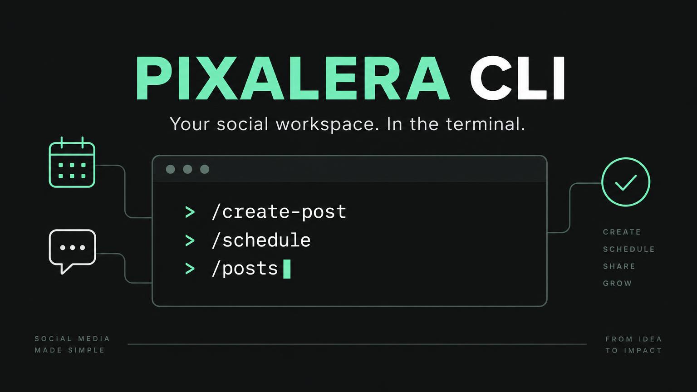
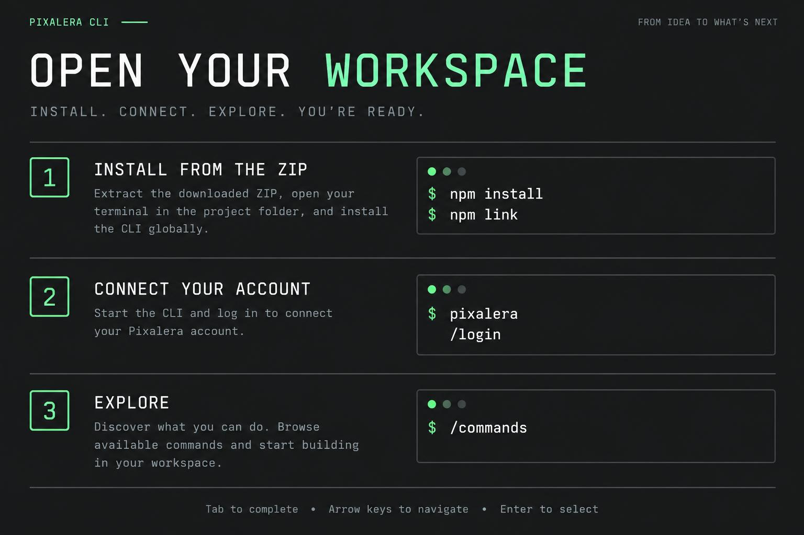
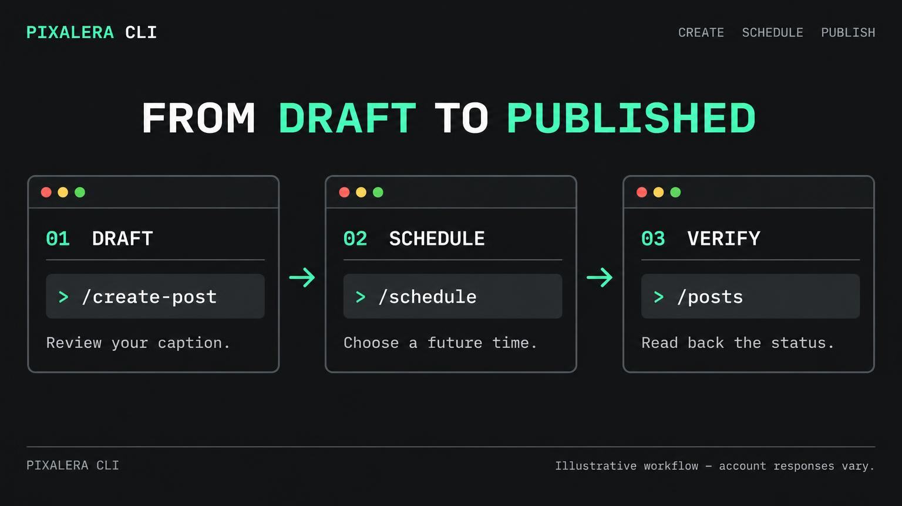

<div align="center">


# Pixalera CLI — Social Media Scheduling & Claude Code MCP

### Your social workspace. In the terminal.

**Create · Schedule · Publish · Measure** — a keyboard-first Pixalera workspace, with guided slash commands and an official MCP bridge for your AI tools.

Schedule social media posts from your terminal, connect Pixalera to Claude Code, Claude Desktop, Cursor or VS Code through the Model Context Protocol (MCP), and review drafts, publishing queues, content ideas and analytics from your connected account.

[Website](https://pixalera.in) · [Get an API key](https://app.pixalera.in/dashboard/settings?section=developers) · [Quick start](#quick-start) · [Keyboard controls](#keyboard-controls) · [Post workflow](#draft--schedule--publish) · [Command reference](#command-reference) · [AI integrations](#connect-an-ai-tool)



**Node.js 22+ · Windows / macOS / Linux · CLI v0.2.0**

</div>

> **What this is:** A Pixalera-branded interactive command workspace inspired by the keyboard workflow of Claude Code. It is not Claude Code, a general-purpose coding agent, or a natural-language AI chat. Your AI app can use its MCP bridge separately.
>
> **Distribution:** This ZIP is source code ready to install locally. This release has not been published to npm and no GitHub repository was created by this update. Do not assume `npm install -g pixalera-cli` installs this version.

## What you can do

| Workspace | Experience |
| --- | --- |
| Interactive shell | Run `pixalera` to open a branded terminal with slash commands, completion and session history |
| Action palette | Browse `/commands` using arrows, Tab / Shift+Tab and type-to-jump |
| Guided post composer | Enter a caption, choose connected platforms with checkboxes and choose draft or scheduling mode |
| Safe publishing | Preview your arguments and explicitly approve changes before they reach your account |
| Post read-back | After changing a post, the CLI requests its details again to show the server's actual status |
| Automation | Use direct commands with structured JSON flags and explicit `--yes` approval |
| AI tools | Run `pixalera mcp`; the official MCP SDK bridges your authenticated live tool catalog over stdio |
| Live capabilities | `/refresh` loads the tools your server actually offers, including any additional enabled capabilities |

## Quick start



### 1. Install Node.js

Install **Node.js 22 or newer** from [nodejs.org](https://nodejs.org). Restart your terminal after installing it.

```sh
node --version
npm --version
```

### 2. Extract this ZIP and install locally

**Windows PowerShell** — assuming the ZIP is in Downloads:

```powershell
cd $HOME\Downloads
Expand-Archive .\pixalera-cli-v0.2.0.zip -DestinationPath .\pixalera-cli-v0.2.0
cd .\pixalera-cli-v0.2.0\pixalera-cli
npm install
npm link
pixalera
```

**macOS / Linux**:

```sh
cd ~/Downloads
unzip pixalera-cli-v0.2.0.zip -d pixalera-cli-v0.2.0
cd pixalera-cli-v0.2.0/pixalera-cli
npm install
npm link
pixalera
```

If global linking is unavailable, run `npm start` or `node bin/pixalera.js` instead. On Windows, if PowerShell blocks `npm.ps1`, use `npm.cmd install` and `npm.cmd link`, then `pixalera.cmd`; do not weaken your machine-wide execution policy.

### 3. Connect your Pixalera account

1. Open [Settings → Developers](https://app.pixalera.in/dashboard/settings?section=developers).
2. Create a Pixalera API key. The server checks its validity and your plan's access permissions.
3. In the interactive terminal, enter:

```text
/login
```

Paste the key into the **masked** prompt. The CLI verifies access before saving it. Then run:

```text
/whoami
/refresh
/commands
```

Avoid entering the key directly into shell commands: your OS may save those in command history. The legacy `pixalera init --key ...` option remains for compatibility; masked login is preferred.

## Keyboard controls

| Where | Key | Action |
| --- | --- | --- |
| Main prompt | Tab | Complete a slash command; press again for matching names |
| Main prompt | ↑ / ↓ | Recall commands from this session only |
| Main prompt | ← / → | Move the text cursor |
| Main prompt | Enter | Run the command or open its guided form |
| `/commands` and choice menus | ↑ / ↓ | Move between actions / choices |
| `/commands` and choice menus | Tab / Shift+Tab | Next / previous choice |
| `/commands` | Type letters | Jump to matching action names |
| Connected-platform checklist | Space | Toggle a platform |
| Forms | Enter | Accept a field or selection |
| Forms | Ctrl+C | Cancel and return to the workspace |
| Main prompt | Ctrl+C or `/exit` | Close the workspace |

Command history stays in memory and disappears when you exit. `/clear` clears the screen. `/help` shows controls. This release supports single-line captions; use `\n` inside an escaped JSON field when a tool accepts structured content, or edit long captions in the dashboard.

## Draft → schedule → publish



> The generated images are explanatory illustrations, not live-account screenshots. IDs and dates below are examples: replace them with your own returned values. Scheduling is not proof of publication — always check the resulting status and any failure reason.

### A. Start with a reviewed draft

The easiest route is `/create-post`. The form asks for your caption, loads your connected platforms, accepts optional media URLs, and offers scheduling modes. Choose **draft** (or skip the mode for the server default), review the payload and confirm.

Direct-command equivalent:

```sh
pixalera channels
pixalera create-post --caption "Our new collection is here. Explore it today." --platforms '["facebook"]' --schedule_mode draft --yes
```

Use the platform names returned by `channels` — **not channel IDs**. Instagram and other platforms may require images/videos and platform-specific fields. Add public HTTPS media when needed:

```sh
pixalera create-post --caption "Our new collection is here." --platforms '["instagram"]' --media_urls '["https://YOUR-OWN-HOST/collection.jpg"]' --schedule_mode draft --yes
```

For maximum PowerShell JSON compatibility, use `--platforms '[\"facebook\"]'` if your older Windows PowerShell changes native-command quoting, or use the guided platform checklist to avoid JSON entirely.

Save the post ID from the real response. The CLI reads back the created post automatically when an ID is returned.

### B. Schedule that draft

In the interactive shell run `/schedule`, paste the post ID, select **time** and enter a future ISO time with an explicit timezone. For example `2027-01-15T10:00:00+05:30` means 10:00 AM IST — replace it with your intended future date.

```sh
pixalera schedule --post_id YOUR_POST_ID --mode time --scheduled_at "2027-01-15T10:00:00+05:30" --yes
pixalera post --post_id YOUR_POST_ID
pixalera posts --status scheduled
pixalera queue --platform facebook
```

Other server-supported modes:

```sh
pixalera schedule --post_id YOUR_POST_ID --mode next_available --yes
pixalera schedule --post_id YOUR_POST_ID --mode prioritize --yes
```

Prioritizing may shift queued posts. Review the queue afterward. The connected account and backend publisher determine whether a scheduled post can publish successfully.

### C. Publish immediately instead

`/publish` asks for the ID, previews the request and asks **“Publish publicly now?”**, defaulting to No. Approving publishes immediately; do not use it merely to check a scheduled post.

```sh
pixalera publish --post_id YOUR_POST_ID
```

For a deliberately approved script:

```sh
pixalera publish --post_id YOUR_POST_ID --yes
pixalera post --post_id YOUR_POST_ID
pixalera posts --status published
```

Check `status`, publish results, failure reason and permalink in the response. Never infer success from the fact that the command started. To return a scheduled item to draft:

```sh
pixalera unschedule --post_id YOUR_POST_ID --yes
```

## Command reference

The bundled core catalog matches the Railway MCP schema. The live server may expose more tools. `/refresh` updates the interactive catalog; `pixalera tools` lists its current schemas. Direct core commands below accept the backend's snake_case field names.

| Command | Purpose | Main flags |
| --- | --- | --- |
| `overview` / `whoami` | Account, plan, credits, channels and post counts | — |
| `channels` | Connected platforms without access tokens | — |
| `posts` | Account drafts, scheduled and published posts | `--status`, `--limit` |
| `post` | One post, result and failure details | `--post_id` |
| `create-post` | Full composer options | `--caption`, `--platforms`, `--media_urls`, `--schedule_mode`, `--scheduled_at` |
| `update-post` | Edit draft/scheduled caption or time | `--post_id`, `--caption`, `--scheduled_at` |
| `schedule` | Exact time, next slot or prioritized queue | `--post_id`, `--mode`, `--scheduled_at` |
| `publish` | Publish immediately, with explicit approval | `--post_id` |
| `unschedule` | Return a scheduled post to draft | `--post_id` |
| `queue` | Scheduled items and next available slot | `--platform` |
| `ideas` | Read the ideas board | `--status`, `--limit` |
| `create-idea` | Save an idea | `--title`, `--description`, `--platforms` |
| `update-idea` | Edit an idea | `--idea_id` plus editable fields |
| `generate-ideas` | Generate ideas; spends credits | `--help` shows current supported fields |
| `convert-idea` | Convert an idea into a post | `--idea_id` |
| `analytics` | Stored analytics snapshot | `--help` |
| `platform-analytics` | Platform's available live analytics | `--help` |
| `products` | Read storefront products | `--help` |

```sh
pixalera create-post --help
pixalera generate-ideas --help
pixalera tools
```

The previous ZIP advertised 23 hard-coded REST commands. Several pointed to unsupported routes. This revision uses **18 verified core MCP schemas** plus the server's dynamic tools, rather than pretending those 23 routes work. Advanced tools loaded with `/refresh` are available interactively and through the MCP bridge.

Legacy `--content`, `--id` and `--scheduledAt` aliases are accepted for post commands. `--channels` is deliberately not translated: channel IDs and platform names are different things.

## Connect an AI tool

Install/link and log in first. The local MCP bridge reads the same saved key and obtains the live tool list. It does **not** print the interactive banner to its protocol output.

### Claude Code

```sh
claude mcp add --transport stdio pixalera -- pixalera mcp
claude mcp list
```

### Claude Desktop or Cursor

Merge this into the client's MCP configuration (do not replace unrelated servers):

```json
{
  "mcpServers": {
    "pixalera": {
      "command": "pixalera",
      "args": ["mcp"]
    }
  }
}
```

If your desktop app cannot resolve global executables, use Node with an absolute local path:

```json
{
  "mcpServers": {
    "pixalera": {
      "command": "node",
      "args": ["/ABSOLUTE/PATH/pixalera-cli/bin/pixalera.js", "mcp"]
    }
  }
}
```

On Windows use escaped paths such as `C:\\Users\\YOUR_NAME\\Downloads\\pixalera-cli\\bin\\pixalera.js`. Use your actual extraction path and Node executable if needed.

### VS Code

VS Code uses a `servers` object in its MCP configuration:

```json
{
  "servers": {
    "pixalera": {
      "type": "stdio",
      "command": "node",
      "args": ["/ABSOLUTE/PATH/pixalera-cli/bin/pixalera.js", "mcp"]
    }
  }
}
```

Suggested prompt: **“Read my connected channels. Create a draft for Facebook about our new collection; show me the caption before scheduling. Ask before publishing or spending credits.”**

A hosted/web assistant that cannot spawn local processes cannot use this stdio command. Use its supported remote-MCP integration instead. This package does not create or deploy an OAuth server.

## Security and reliability

- Masked `/login` verifies your key before replacing the saved one.
- Local key storage is `~/.config/pixalera/config.json`. On macOS/Linux the file is restricted to the owning user; on Windows protect it with your user-profile permissions. It is local plaintext, not an encrypted system keychain.
- `PIXALERA_API_KEY` overrides the saved key. `/logout` removes the saved key, not environment variables.
- The remote server owns account access, plan checks, credits and rate limits. CLI validation does not replace server authorization.
- HTTPS is required except for loopback local tests; redirects are not followed with credentials.
- All mutating interactive actions ask for approval by default. For scripts, `--yes` is deliberate approval, including public publishing and paid generation.
- MCP tools remain subject to client approval policies; the bridge does not invent a terminal prompt inside an MCP request. Configure your AI client's approvals before allowing write tools.
- Network and server errors surface to the terminal; the CLI does not retry public publishing automatically.
- JSON schema rejects unknown fields; schedules must be future ISO datetimes with a timezone.
- No API keys, account exports, dependencies or Git metadata are included in the ZIP.

## Pixalera services: scheduling, analytics, AutoDM and storefronts

Pixalera CLI focuses on social media scheduling and account workflows. Availability depends on the tools exposed by your deployed server and your account permissions—not on a list of marketing keywords.

| Service | How this repository relates to it |
| --- | --- |
| Social media post scheduling | Create drafts, schedule posts, inspect the queue and verify publishing status |
| Instagram and Facebook scheduling | Use your connected platform names and required media; platform-specific permissions still apply |
| Claude Code social media tools | Attach the local MCP bridge and let your assistant use approved account tools |
| Content ideas and AI generation | Read/save ideas, generate ideas using account credits and convert ideas to posts |
| Social media analytics | Read stored snapshots or supported platform analytics |
| Link in Bio products | Read storefront products with the core `products` command |
| AutoDM automation and inbox | Not a standalone AutoDM scheduling engine: only use additional AutoDM/inbox tools if `pixalera tools` or `/refresh` lists them |
| eBooks and other workspace services | No bundled command is promised; discover enabled live tools and use the dashboard for unavailable actions |

### Is this a Claude skill or an MCP server?

This package provides a **CLI and local MCP bridge**, not a pre-installed Claude skill. MCP supplies callable account tools; a Claude skill supplies instructions/workflows. Connect the bridge using the Claude Code configuration above, and keep publishing approvals enabled. Do not install arbitrary skills or paste API keys into prompts.

### Can I schedule social posts from a GitHub repository?

Yes: clone or download this CLI's source, install it locally, connect your own Pixalera account and use the scheduling commands. GitHub hosts the code; Pixalera's server and connected social accounts execute the publishing workflow. Uploading this repository does not create a scheduler or AutoDM service on GitHub.

### Can this repository rank first for Pixalera or social media scheduling?

No ranking is guaranteed. A public, useful repository with accurate documentation can be discovered by GitHub search and may be indexed by Google. Visibility depends on indexing, relevance, competition, links and reputation; private repositories are not public search results.

## GitHub discoverability checklist

After pushing to your real public repository:

1. Set its **About description** to: `Pixalera CLI for social media scheduling, publishing and analytics, with a Claude Code MCP bridge.`
2. Set the **Website** to `https://pixalera.in`.
3. Add accurate topics: `pixalera`, `cli`, `social-media`, `social-media-scheduling`, `post-scheduling`, `mcp`, `mcp-server`, `model-context-protocol`, `claude-code`, `social-media-analytics`. Add `autodm` only if the deployed integration actually exposes it. GitHub permits up to 20 topics; avoid unrelated tags.
4. Keep this README in the repository root, retain installation/workflow examples and descriptive image alt text, and publish real versioned releases with tested change notes.
5. Add the **actual repository URL** to relevant Pixalera setup guides after the repository exists. Never use a fabricated repository URL or paid spam links.
6. Keep documentation current and add real, non-sensitive examples as the integration evolves. Do not hide keyword lists, duplicate this README across unrelated repositories or claim services that are not implemented.

GitHub repository search supports README matching with a qualifier, for example `pixalera in:readme` or `social-media-scheduling in:topics`. Google search is separate; GitHub hosting and tags do not guarantee Google indexing. A README cannot install site-wide meta tags, structured data or a custom canonical on GitHub's repository page.

References: [GitHub repository search](https://docs.github.com/en/search-github/searching-on-github/searching-for-repositories), [repository topics](https://docs.github.com/en/repositories/managing-your-repositorys-settings-and-features/customizing-your-repository/classifying-your-repository-with-topics), [Google SEO fundamentals](https://developers.google.com/search/docs/fundamentals/seo-starter-guide).

## Troubleshooting

| Problem | What to do |
| --- | --- |
| `pixalera` not found | Run `npm link` from the extracted folder, restart your terminal, or use `node bin/pixalera.js` |
| No API key | Open `pixalera`, then `/login` |
| Invalid/revoked key or plan access error | Generate a valid key in Developers and check your plan's agent access |
| Rate limit | Wait for the server's stated reset; avoid repeatedly retrying write actions |
| Missing advanced tool | `/refresh` or `pixalera tools`; the deployed Railway server must offer it |
| Unsupported field | Run the command with `--help`; use current snake_case fields |
| Date rejected | Choose a future date and include `Z` or a timezone offset |
| Post did not publish | Read `pixalera post --post_id ...`; inspect failure reason, media requirements and connected-account health |
| Terminal arrows not working | Use a normal interactive terminal, not a redirected pipeline |
| AI client cannot launch the bridge | Use an absolute Node + script path and restart that client |

## Development and GitHub

```sh
npm install
npm test
```

The tests include schema validation and a local authenticated MCP fixture exercising draft → schedule → publish → read-back. **They do not establish a successful real-account publication.** No usable Pixalera API key was supplied for a live-account test in this update.

To push this folder to **your own empty GitHub repository**, after creating it on GitHub:

```sh
git init
git add .
git commit -m "Add interactive Pixalera CLI"
git branch -M main
git remote add origin https://github.com/YOUR_USERNAME/pixalera-cli.git
git push -u origin main
```

Replace `YOUR_USERNAME` with your real username. Never add your local key file. Before an npm release, verify package-name ownership, pick your license and add your actual repository URL to `package.json`; then perform your release checks. A repository or npm listing is not created just by downloading this ZIP.

---

<div align="center">

**Pixalera CLI** · Built for creators who like their workspace one command away.

[Pixalera](https://pixalera.in) · [Dashboard](https://app.pixalera.in)

</div>
